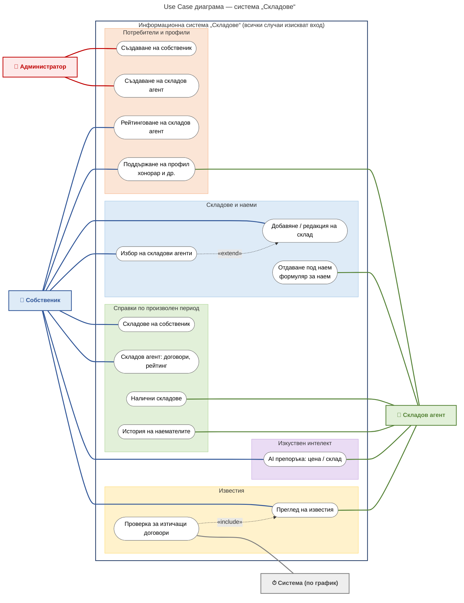
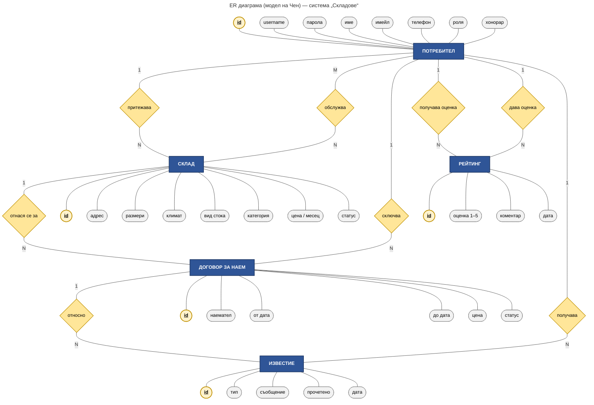
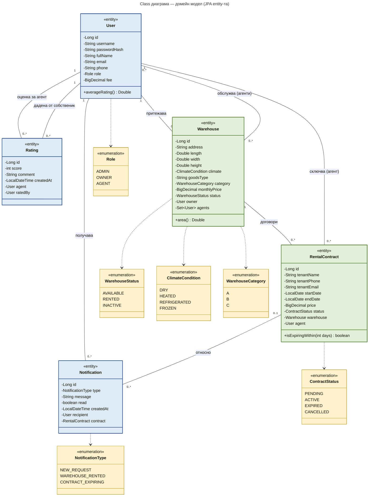
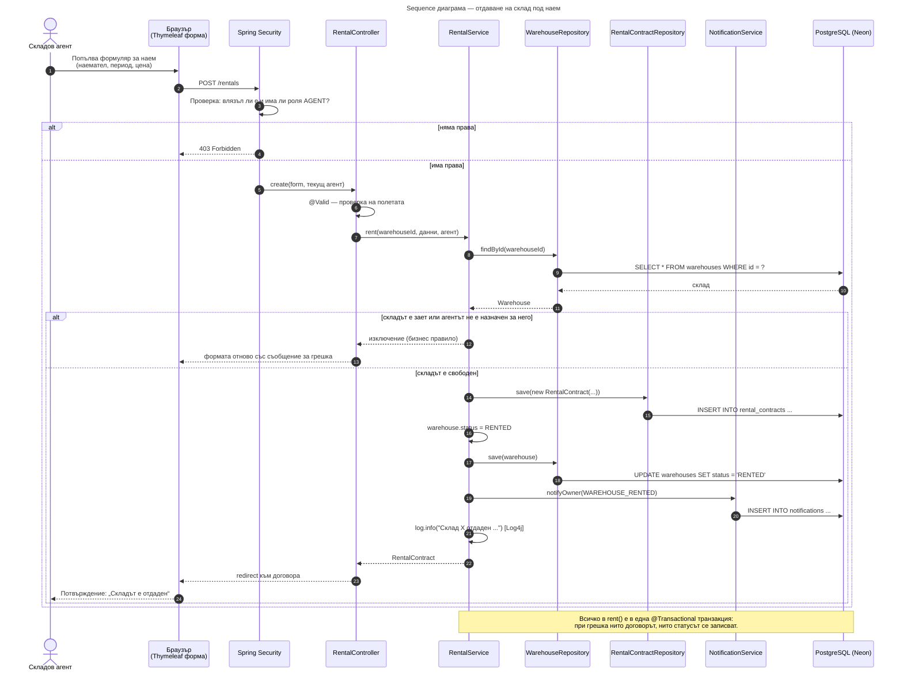
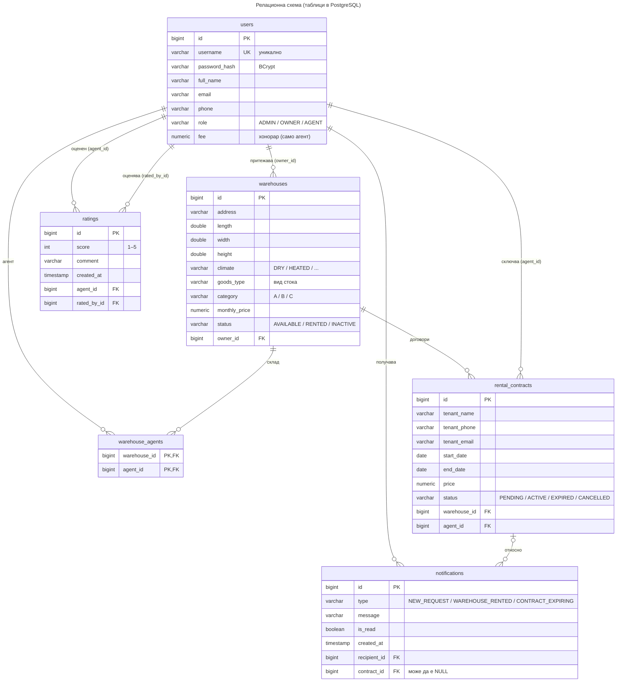

# Диаграми на системата „Складове“ (Mermaid)

Диаграмите са написани на [Mermaid](https://mermaid.js.org) и се показват директно в GitHub
и в IntelliJ (Markdown preview). Всяка е и в отделен `.mmd` файл, а `.png` картинките са за документацията.

| Файл | Какво показва | Изискване от заданието |
|---|---|---|
| `use-case.mmd` | Кой потребител какво може да прави | 2.d.ii UML – Use Case |
| `er-chen.mmd` | Концептуален модел на базата | 2.d.iii ER диаграма (модел на Чен) |
| `class-diagram.mmd` | JPA entity класовете и връзките им | 2.d.ii UML – Class Diagram |
| `sequence-rental.mmd` | Как минава заявката за отдаване под наем | 2.d.ii UML – Sequence diagram |
| `er-relational.mmd` | Таблиците в PostgreSQL с ключовете | 2.e.i Релационна схема |

Картинките се генерират с Mermaid CLI: `npx -p @mermaid-js/mermaid-cli mmdc -i er-chen.mmd -o er-chen.png -s 2 -b white`

## 1. Use Case диаграма
Цветът на линията показва кой актьор използва случая: червено = администратор, синьо = собственик,
зелено = складов агент. «extend» = по желание, «include» = винаги.

## 2. ER диаграма (модел на Чен)
Правоъгълник = обект, ромб = връзка, овал = атрибут, подчертан атрибут = първичен ключ,
1 / N / M = кардиналност.

## 3. Class диаграма
Синьо = модули на Човек A (потребители, рейтинг, известия), зелено = модули на Човек B (складове, наеми),
жълто = enum. `-` = private поле, `+` = public метод.

## 4. Sequence диаграма: отдаване на склад под наем
Показва многослойната архитектура: Controller → Service → Repository → база данни.

## 5. Релационна схема
`PK` = първичен ключ, `FK` = външен ключ, `UK` = уникална стойност.
Връзката M:N между склад и агент става чрез свързващата таблица `warehouse_agents`.

## Проектни решения

- **Една таблица за всички потребители** с колона `role` (ADMIN, OWNER, AGENT). Входът и правата се правят
  на едно място (Spring Security), а хонорарът (`fee`) се ползва само при агентите.
- **Наемателят не е потребител на системата.** Той не влиза в нея, затова данните му се пазят в договора.
- **Заявката за наем е договор със статус `PENDING`.** При одобрение става `ACTIVE`, след крайната дата `EXPIRED`.
- **Агентите на склад са M:N,** защото собственикът избира „един или списък“ агенти, а един агент работи с много складове.
- **Известието за изтичащ договор** се създава автоматично по график (`@Scheduled`), затова в Use Case има актьор „Система“.
