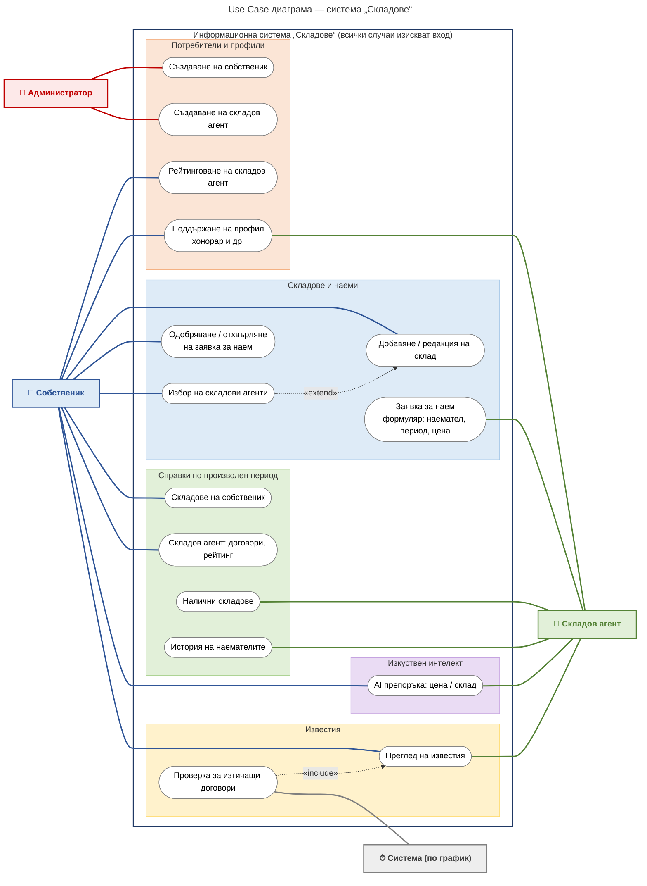
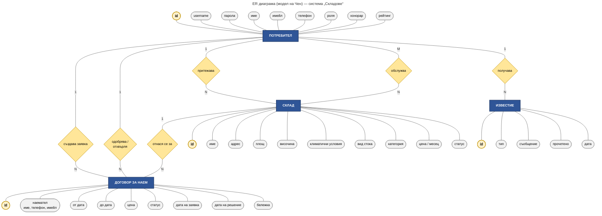
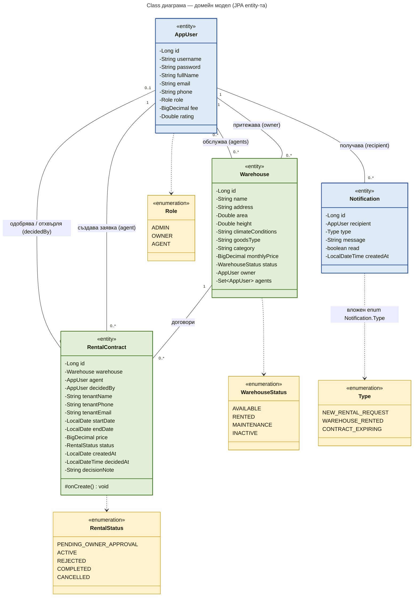
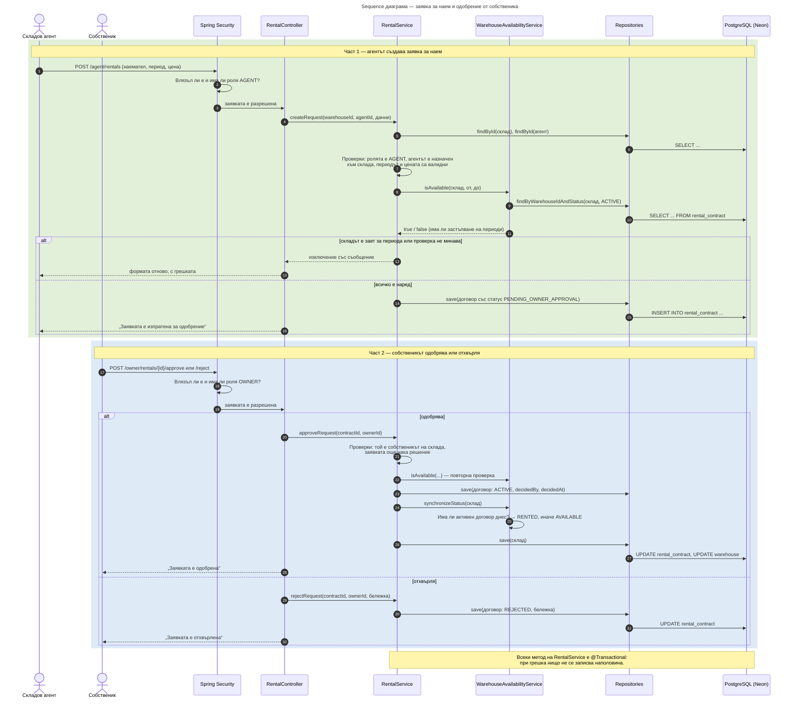
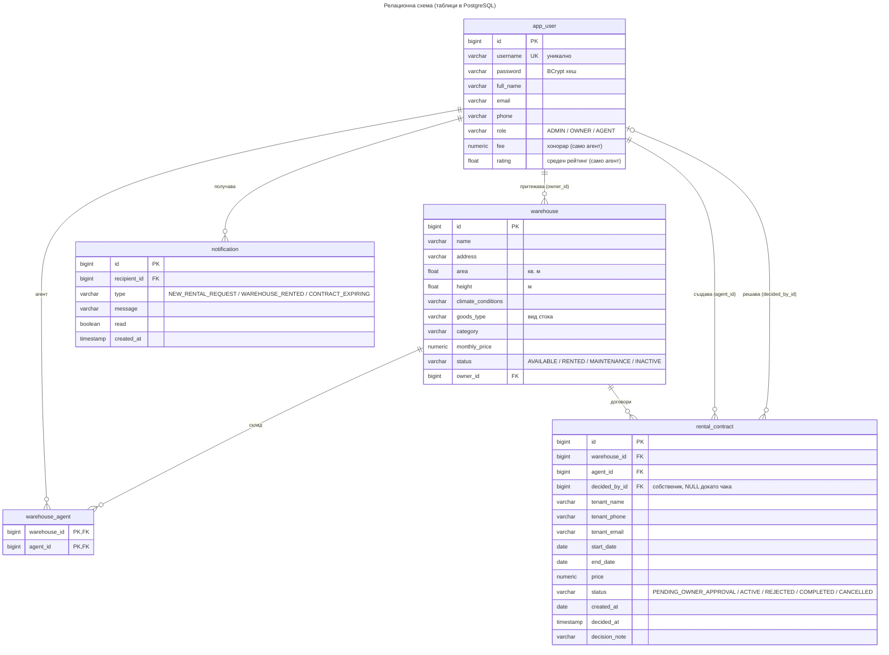

# Диаграми на системата „Складове“ (Mermaid)

Диаграмите са написани на [Mermaid](https://mermaid.js.org) и се показват директно в GitHub
и в IntelliJ (Markdown preview). Всяка е и в отделен `.mmd` файл, а `.png` картинките са за документацията.
Диаграмите отразяват кода в `src/main/java/bg/skladove` (entity-та, enum-и, `RentalService`).

| Файл | Какво показва | Изискване от заданието |
|---|---|---|
| `use-case.mmd` | Кой потребител какво може да прави | 2.d.ii UML – Use Case |
| `er-chen.mmd` | Концептуален модел на базата | 2.d.iii ER диаграма (модел на Чен) |
| `class-diagram.mmd` | JPA entity класовете и връзките им | 2.d.ii UML – Class Diagram |
| `sequence-rental.mmd` | Заявка за наем и одобрение от собственика | 2.d.ii UML – Sequence diagram |
| `er-relational.mmd` | Таблиците в PostgreSQL с ключовете | 2.e.i Релационна схема |

Картинките се генерират с Mermaid CLI: `npx -p @mermaid-js/mermaid-cli mmdc -i er-chen.mmd -o er-chen.png -s 2 -b white`

## 1. Use Case диаграма
Цветът на линията показва кой актьор използва случая: червено = администратор, синьо = собственик,
зелено = складов агент. «extend» = по желание, «include» = винаги.

## 2. ER диаграма (модел на Чен)
Правоъгълник = обект, ромб = връзка, овал = атрибут, подчертан атрибут = първичен ключ,
1 / N / M = кардиналност.

## 3. Class диаграма
Синьо = модули на Човек A (потребители, известия), зелено = модули на Човек B (складове, наеми),
жълто = enum. `-` = private поле, `#` = protected метод.

## 4. Sequence диаграма: заявка за наем и одобрение
Показва многослойната архитектура (Controller → Service → Repository → база данни)
и двете стъпки на наема: агентът създава заявка, собственикът я одобрява или отхвърля.

## 5. Релационна схема
`PK` = първичен ключ, `FK` = външен ключ, `UK` = уникална стойност.
Връзката M:N между склад и агент става чрез свързващата таблица `warehouse_agent`.

## Проектни решения

- **Една таблица за всички потребители** (`app_user`) с колона `role` (ADMIN, OWNER, AGENT).
  Входът и правата се правят на едно място (Spring Security). Хонорарът (`fee`) и средният рейтинг
  (`rating`) се ползват само при агентите.
- **Наемателят не е потребител на системата.** Той не влиза в нея, затова данните му се пазят в договора.
- **Наемът минава през одобрение.** Агентът създава заявка (`PENDING_OWNER_APPROVAL`), собственикът
  я одобрява (`ACTIVE`) или отхвърля (`REJECTED`, с бележка). Кой и кога е решил се пази в
  `decided_by_id` и `decided_at`.
- **Свободен ли е складът се проверява по периоди**, а не само по статус: заявка се приема, само ако
  периодът ѝ не се застъпва с активен договор (`WarehouseAvailabilityService.isAvailable`).
  Статусът на склада (`RENTED` / `AVAILABLE`) се пресмята от активните договори (`synchronizeStatus`).
- **Агентите на склад са M:N,** защото собственикът избира „един или списък“ агенти, а един агент работи с много складове.
- **Известието за изтичащ договор** ще се създава автоматично по график (`@Scheduled`), затова в Use Case има актьор „Система“.
